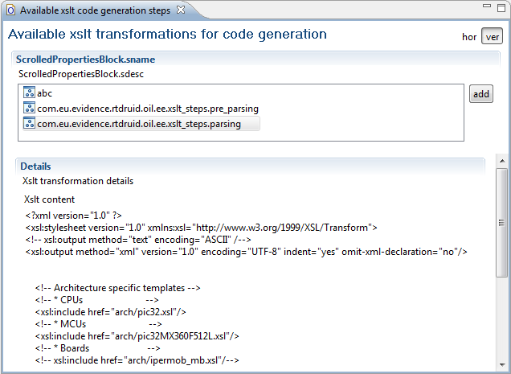

# File:Xslttutorial availeble xslt files.png

[Download original file](../assets/uploads/Xslttutorial_availeble_xslt_files--b260fdd3bb.png)

Original upload: **Paolo.gai**, 2010-10-27T14:23:36Z; 32,561 bytes; `image/png`.

Upload comment: Available XSLT transformations for code generation

Available XSLT transformations for code generation

---

## Archive provenance

- [Original page](http://erika.tuxfamily.org/wiki/index.php?title=File%3AXslttutorial_availeble_xslt_files.png) · [Archived source revision 2100](http://erika.tuxfamily.org/wiki/index.php?oldid=2100)
- Last source edit: 2010-10-27T14:23:36Z. Source retrieved on 2026-11-06; Markdown conversion completed on 2026-11-07.
- Original contributors recorded in exported history: Paolo.gai.
- [Original MediaWiki source](../source/wikitext/1688.mediawiki) · [Original editing history](../source/history/batch-056.xml)
- [Attribution and licensing notice](../NOTICE.md). Original file-specific notices, where present, remain applicable.
