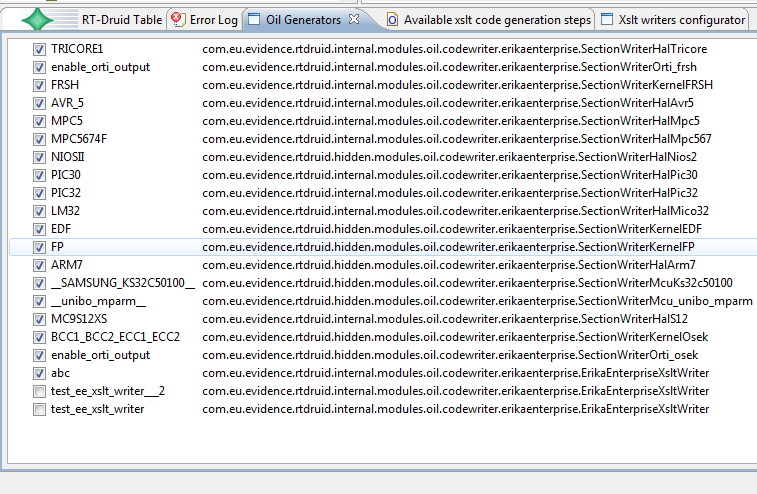

# File:Xslttutorial enabled writers.png

[Download original file](../assets/uploads/Xslttutorial_enabled_writers--3a0b8f6014.png)

Original upload: **Paolo.gai**, 2010-10-27T14:19:19Z; 61,385 bytes; `image/png`.

Upload comment: The list of enabled writers

The list of enabled writers

---

## Archive provenance

- [Original page](http://erika.tuxfamily.org/wiki/index.php?title=File%3AXslttutorial_enabled_writers.png) · [Archived source revision 2099](http://erika.tuxfamily.org/wiki/index.php?oldid=2099)
- Last source edit: 2010-10-27T14:19:19Z. Source retrieved on 2026-11-06; Markdown conversion completed on 2026-11-07.
- Original contributors recorded in exported history: Paolo.gai.
- [Original MediaWiki source](../source/wikitext/1687.mediawiki) · [Original editing history](../source/history/batch-056.xml)
- [Attribution and licensing notice](../NOTICE.md). Original file-specific notices, where present, remain applicable.
