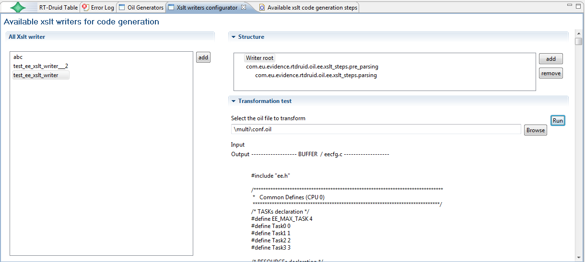

# File:Xslttutorial xslt chain output.png

[Download original file](../assets/uploads/Xslttutorial_xslt_chain_output--9bea06f207.png)

Original upload: **Paolo.gai**, 2010-10-27T14:42:03Z; 37,802 bytes; `image/png`.

Upload comment: Output of the XSLT writer obtained clicking on the writer root

Output of the XSLT writer obtained clicking on the writer root

---

## Archive provenance

- [Original page](http://erika.tuxfamily.org/wiki/index.php?title=File%3AXslttutorial_xslt_chain_output.png) · [Archived source revision 2104](http://erika.tuxfamily.org/wiki/index.php?oldid=2104)
- Last source edit: 2010-10-27T14:42:03Z. Source retrieved on 2026-11-06; Markdown conversion completed on 2026-11-07.
- Original contributors recorded in exported history: Paolo.gai.
- [Original MediaWiki source](../source/wikitext/1691.mediawiki) · [Original editing history](../source/history/batch-056.xml)
- [Attribution and licensing notice](../NOTICE.md). Original file-specific notices, where present, remain applicable.
