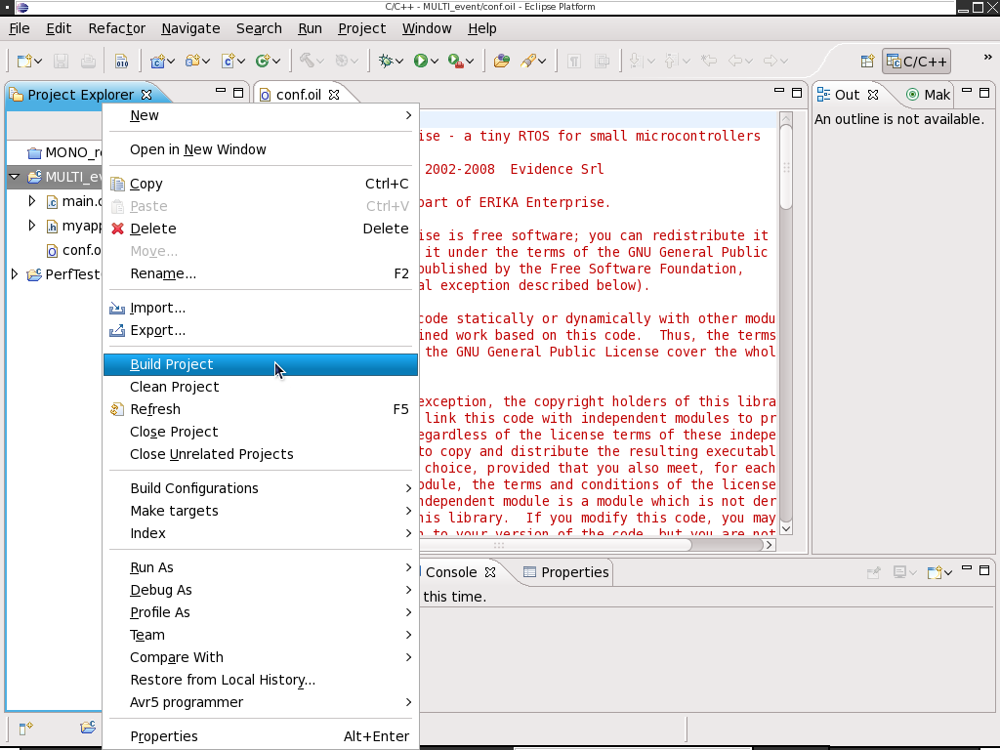

# File:Z7-rtd-build.png

[Download original file](../assets/uploads/Z7-rtd-build--1071ba495f.png)

Original upload: **Fchecconi**, 2010-05-27T11:14:55Z; 177,365 bytes; `image/png`.

---

## Archive provenance

- [Original page](http://erika.tuxfamily.org/wiki/index.php?title=File%3AZ7-rtd-build.png) · [Archived source revision 2002](http://erika.tuxfamily.org/wiki/index.php?oldid=2002)
- Last source edit: 2010-05-27T11:14:55Z. Source retrieved on 2026-11-06; Markdown conversion completed on 2026-11-07.
- Original contributors recorded in exported history: Fchecconi.
- [Original MediaWiki source](../source/wikitext/1630.mediawiki) · [Original editing history](../source/history/batch-057.xml)
- [Attribution and licensing notice](../NOTICE.md). Original file-specific notices, where present, remain applicable.
